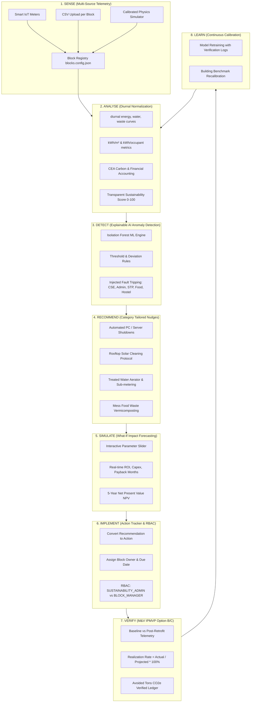

# ⚡ ECHOTECH — AI-Powered Smart Campus Sustainability Platform
### Block-Wise Sustainability Intelligence for Presidency University, Bengaluru

> **Primary Objective:** "Create a prototype that analyses energy, water or waste data, identifies inefficiencies and recommends measurable ways to reduce consumption. Connect this to your campus."

---

## 🏛️ Official Presidency University Sustainability Context & Block Registry

**Location:** Itgalpur, Rajanakunte, Yelahanka, Bengaluru, Karnataka 560064 (64-acre campus)  
**Climate Zone:** Tropical Savanna (Elevation 920m, Bengaluru)  
**Primary Grid Emission Factor:** 0.716 kg $CO_2e$/kWh (Central Electricity Authority, CEA India CO2 Database)  
**Water Treatment Factor:** 0.45 kg $CO_2e$/kL  
**Food Waste Factor:** 1.90 kg $CO_2e$/kg  
**Electricity Commercial Tariff:** ₹8.50/kWh  

### Campus-Wide Ground Truth Benchmarks:
1. **☀️ Rooftop Solar PV Generation (220 kWp on Administration Building):** ~800 kWh/day average generation.
2. **💧 Wastewater Treatment & Recycling (Sewage Treatment Plant - STP):** ~300,000 Litres (300 kL) treated daily with ~88% recycled for landscape irrigation and toilet flushing.
3. **♻️ Cafeteria Food Waste & Organic Vermicomposting:** 120–150 kg/day generated and composted on campus.
4. **🏢 13-Block Built Environment:** 13 key campus facilities, each modeled as a first-class entity with floor area, occupancy, distinct daily diurnal profiles, and telemetry.

### Registered Campus Blocks (`server/data/blocks.config.json`):

| Block ID | Building Name | Category | Area ($m^2$) | Occupancy | Solar (kWp) | Manager Role | Injected Demo Signature / Fault |
| :--- | :--- | :--- | :--- | :--- | :--- | :--- | :--- |
| **ADMIN** | Management / Admin Block | Administrative | 8,500 | 320 | 220 kWp | `ADMIN_MANAGER` | Rooftop solar soiling (PR < 0.65, ~280 kWh/day lost) |
| **CSE** | Computer Science & Engg | Academic-Lab | 12,000 | 1,400 | — | `CSE_MANAGER` | Idle lab baseload > 35% of peak at night (22:00-05:00) |
| **ENGG** | Engineering Block | Academic-Lab | 14,000 | 1,600 | — | `ENGG_MANAGER` | High 09:00-17:00 academic peak demand |
| **CIVIL** | Civil Engineering Block | Academic-Lab | 9,500 | 850 | — | `CIVIL_MANAGER` | Lab equipment load-shifting opportunities |
| **LIB** | Library & Learning Centre | Library | 6,000 | 600 | — | `LIB_MANAGER` | Long-hour HVAC & lighting baseload |
| **ARCH** | Architecture & Design | Academic-Studio | 7,200 | 550 | — | `ARCH_MANAGER` | Studio high daylight, HVAC scheduling |
| **COMM** | Commerce & Management | Academic | 8,000 | 950 | — | `COMM_MANAGER` | Standard lecture timetable profile |
| **HOSTEL_B** | Boys Hostels (Cluster) | Residential | 18,000 | 1,200 | — | `HOSTEL_B_MANAGER`| Morning & evening shower/lighting peaks |
| **HOSTEL_G** | Girls Hostels (Cluster) | Residential | 16,000 | 1,100 | — | `HOSTEL_G_MANAGER`| Sub-surface water line leak signature (constant flow) |
| **FOOD** | Central Food Court & Mess | Food-Service | 4,500 | 2,800 | — | `FOOD_MANAGER` | Food surplus surge > 200 kg/day; mealtime peaks |
| **SPORTS** | Indoor & Outdoor Sports | Recreational | 5,000 | 400 | — | `SPORTS_MANAGER`| Intermittent event-based electricity & water |
| **AUD** | University Auditorium | Assembly | 3,800 | 1,500 | — | `AUD_MANAGER` | High peak chiller spikes during scheduled convocations |
| **STP** | Sewage Treatment Plant | Utility | 1,500 | 15 | — | `STP_MANAGER` | Discharge flow spike > 340 kL/day anomaly |

---

## 🔄 Block-Level Closed-Loop SENSE → LEARN Workflow



---

## 🏗️ Technical Architecture & Block Registry Layer

```
5hh/
├── client/                               # Frontend: React 19 + Vite 8 + Tailwind CSS v4 + Recharts
│   ├── public/blocks/                    # Public block photography directory (with README.md)
│   ├── src/
│   │   ├── components/
│   │   │   ├── BlockImage.jsx            # Aspect-stable lazy-loading image with SVG/gradient fallback
│   │   │   ├── Navbar.jsx                # Header with Global Block Selector & Role Switcher
│   │   │   └── Sidebar.jsx               # Navigation with "Block Intelligence" group
│   │   ├── context/
│   │   │   └── CampusContext.jsx         # Global state with active block, role auth & REST sync
│   │   ├── pages/
│   │   │   ├── BlockExplorerPage.jsx     # Responsive 12-block card grid with score rings & filters
│   │   │   ├── CampusMapPage.jsx         # Interactive SVG heatmap site map with metric shading
│   │   │   ├── BlockDetailPage.jsx       # 10-Tab deep dive for every building
│   │   │   ├── BlockComparePage.jsx      # Radar & Bar side-by-side comparison (2-4 blocks)
│   │   │   ├── LeaderboardPage.jsx       # Ranked sustainability standings & podium
│   │   │   ├── OverviewPage.jsx          # Campus rollup, Top Consumers & Attention blocks
│   │   │   ├── SolarIntelligencePage.jsx # 220 kWp array, diurnal curve, soiling detection
│   │   │   ├── WaterIntelligencePage.jsx # STP 300 kL mass balance & leak monitoring
│   │   │   ├── WasteIntelligencePage.jsx # Food waste segregation & vermicomposting
│   │   │   ├── InefficienciesPage.jsx    # Campus & block filtered anomaly radar
│   │   │   ├── SimulatorPage.jsx         # What-If ROI / Payback / NPV forecasting
│   │   │   ├── ActionTrackerPage.jsx     # Implementation lifecycle tracker
│   │   │   ├── ImpactVerificationPage.jsx# IPMVP Option B/C savings ledger
│   │   │   └── MLCenterPage.jsx          # ML model performance, holdout metrics & clustering
│   │   └── utils/                        # Formatters for INR, kWh, Litres, and CEA carbon factors
├── server/                               # Backend Gateway: Node.js Express 4 (Port 5001)
│   ├── data/
│   │   ├── blocks.config.json            # SINGLE SOURCE OF TRUTH: 13 Campus Blocks metadata
│   │   ├── presidencyCampus.js           # Block config exports and lookup helpers
│   │   ├── syntheticGenerator.js         # Multi-block calibrated hourly telemetry generator
│   │   └── store.js                      # Memory store with persistence, scores & aggregation
│   ├── engine/
│   │   ├── anomalyEngine.js              # Multi-resource, block-aware explainable detector
│   │   └── recommendationsEngine.js      # Category-specific nudges, ROI & 5-year NPV math
│   ├── routes/
│   │   └── api.js                        # Block endpoints, RBAC middleware, Multer CSV ingest
│   ├── tests/
│   │   └── block_aggregation.test.js     # Unit tests verifying block sum == campus total (<1%)
│   ├── scripts/
│   │   └── seed.js                       # Deterministic data generation script (npm run seed)
│   └── index.js                          # Express Server & ML proxy to Flask (:5002)
├── ml_service/                           # Machine Learning Microservice: Python 3.12 Flask (:5002)
│   ├── app.py                            # Block Anomaly Detection, Forecast, Cluster, Verify
│   └── requirements.txt                  # Flask, scikit-learn, numpy, pandas, scipy
└── README.md                             # Documentation, architecture, API reference & guide
```

---

## 📡 REST API & Machine Learning Endpoint Reference

### Block Registry & Analytics (`server/routes/api.js` on port `:5001`)

| Method | Endpoint | Description | Access Control |
| :--- | :--- | :--- | :--- |
| `GET` | `/api/blocks` | List all 13 blocks with latest telemetry, scores, and active alert counts | Public / Authenticated |
| `GET` | `/api/blocks/:id` | Full block profile, KPIs, floor area, category, and diurnal curve | Public / Block Scoped |
| `GET` | `/api/blocks/:id/resources/:type` | Hourly/daily time series for electricity, solar, water, or waste | Public / Block Scoped |
| `GET` | `/api/blocks/:id/alerts` | Active and historical anomalies scoped to the block | Public / Block Scoped |
| `GET` | `/api/blocks/:id/recommendations` | Category-tailored efficiency nudges with ROI & NPV | Public / Block Scoped |
| `GET` | `/api/blocks/:id/actions` | Implementation tasks scoped to the block | Public / Block Scoped |
| `POST`| `/api/blocks/:id/actions` | Create a new action bound to the block | `SUSTAINABILITY_ADMIN` or owner `BLOCK_MANAGER` |
| `GET` | `/api/blocks/:id/impact` | IPMVP Option B measurement and verification records | Public / Block Scoped |
| `GET` | `/api/blocks/compare?ids=A,B,C` | Side-by-side benchmarking (radar + bar chart data) | Public / Authenticated |
| `GET` | `/api/blocks/leaderboard` | Ranked leaderboard by score, energy intensity, or carbon | Public / Authenticated |
| `POST`| `/api/blocks/:id/upload` | Multer multipart CSV upload for block telemetry | `SUSTAINABILITY_ADMIN` or owner `BLOCK_MANAGER` |

### Machine Learning Service (`ml_service/app.py` on port `:5002`, proxied via `/ml/*`)

| Method | Endpoint | Algorithm / Model | Purpose |
| :--- | :--- | :--- | :--- |
| `POST` | `/ml/blocks/anomaly-detect` | **Isolation Forest** (`contamination=0.08`) | Multi-feature anomaly detection (rate, normalized dev, hour, night/day ratio) |
| `POST` | `/ml/blocks/forecast` | **Random Forest Regressor** vs Linear Baseline | 24-48h load prediction with MAE/RMSE benchmark and feature importances |
| `POST` | `/ml/blocks/cluster` | **K-Means** ($k=3$) | Unsupervised grouping: High-Peak Academic, Baseload Residential, Intermittent |
| `POST` | `/ml/blocks/simulate` | Deterministic Parametric Physics Model | What-If parameter estimation, capex, monthly savings, ROI, 5-yr NPV |
| `POST` | `/ml/blocks/verify` | **IPMVP Option B & C** Engine | Baseline vs post-intervention realization rate ($Actual / Projected \times 100$) |

---

## 🔒 Role-Based Access Control (RBAC)

The system enforces server-side role security via HTTP request headers:
- `x-user-role`: `SUSTAINABILITY_ADMIN` or `BLOCK_MANAGER`
- `x-user-block`: e.g. `CSE`, `ADMIN`, `FOOD`, etc.

**Rule:** A `BLOCK_MANAGER` assigned to `CSE` cannot POST actions or upload telemetry for `ADMIN` or any other block. The server strictly rejects cross-block mutations with `HTTP 403 Forbidden`.

---

## 🧪 Testing, Seeding & Validation

### Run Deterministic Unit Tests
```bash
cd server
npm test
```
Validates:
- Mathematical aggregation: Sum of block electricity, solar, water, and waste equals campus totals within 1%.
- Transparent sustainability score formula calculation (0–100 scale).
- Server-side RBAC enforcement: 403 Forbidden on unauthorized cross-block operations.
- CSV ingestion validation and schema conformity.

### Regenerate Deterministic Campus Data
```bash
cd server
npm run seed
```

---

## 🚀 Running the Full Stack

### 1. Python ML Service (Port 5002)
```bash
cd ml_service
pip install -r requirements.txt
python app.py
```

### 2. Express Backend Gateway (Port 5001)
```bash
cd server
npm install
node index.js
```

### 3. React Frontend (Port 3000)
```bash
cd client
npm install
npm run dev
```

Visit **`http://localhost:3000`** in your browser.
